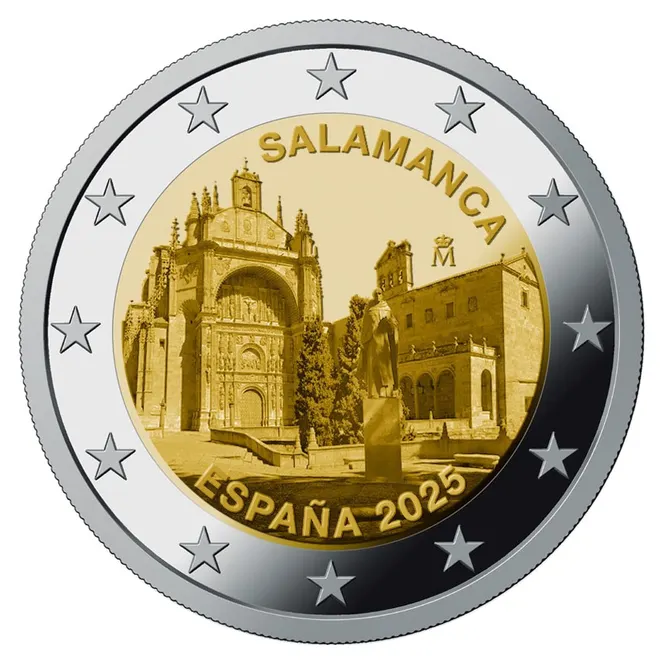

# Spain € 2.00

## Images

## Metadata

**Country:** [Spain](../../Countries/Spain/index.md)\
**Serie:** [Spanish UNESCO World Heritage](index.md)\
**Monetary value:** € 2.00\
**Currency:** Euro\
**Issue date:** 2025-03-10\
**Designer:**

## Description

The old city of Salamanca

## Mintages

| Year | Mintmark | Circulated | Brilliant Uncirculated | Proof |
| ---- | -------- | ---------- | ---------------------- | ----- |
| 2025 |          | 2000000    | 0                      | 6500  |

### Sources

- [Mintage Circulated](https://www.boe.es/eli/es/o/2024/11/26/ecm1359)
- Mintages Proof [1](https://tienda.fnmt.es/fnmttv/fnmt/es/Productos/Monedas/CARTERITA-2-EURO-PROOF-SALAMANCA-2025/p/32107202), [2](https://tienda.fnmt.es/fnmttv/fnmt/es/Productos/Monedas/Web/Eurosets-2025/EUROSET-PROOF-A%C3%91O-2025/p/32777106)
