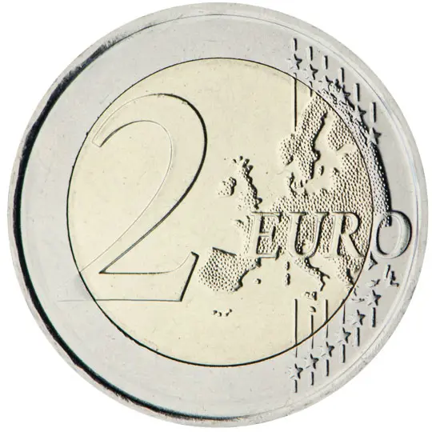

# Andorra € 2.00

## Images

## Metadata

**Country:** [Andorra](../../Countries/Andorra/index.md)\
**Monetary value:** € 2.00\
**Currency:** Euro\
**Issue date:** 2026 Q4\
**Designer:** 

## Description

50th Anniversary of the Inauguration of the new Sanctuary of Meritxell

## Mintages

| Year | Mintmark | Circulated | Brilliant Uncirculated | Proof |
| ---- | -------- | ---------- | ---------------------- | ----- |
| 2026 |          | 0          | 60000                  | 0     |

### Sources

- [Mintage BU](https://www.govern.ad/ca/w/el-govern-aprova-l-emissio-de-monedes-d-euro-andorranes-per-al-2026-per-un-valor-de-6-039-160-euros)
