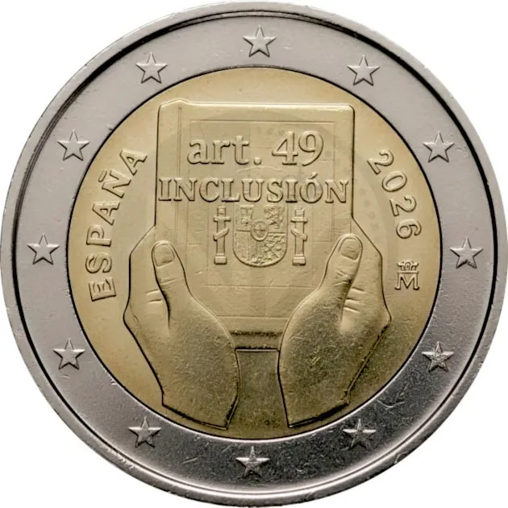

# Spain € 2.00

## Images

## Metadata

**Country:** [Spain](../../Countries/Spain/index.md)\
**Monetary value:** € 2.00\
**Currency:** Euro\
**Issue date:** 2026-03-24\
**Designer:**

## Description

Spain and Disability: Protection, Rights and Inclusion

## Mintages

| Year | Mintmark | Circulated | Brilliant Uncirculated | Proof |
| ---- | -------- | ---------- | ---------------------- | ----- |
| 2026 |          | 1500000    | 0                      | 6500  |

### Sources

- [Mintage Circulated](https://www.boe.es/buscar/doc.php?id=BOE-A-2025-22663)
- Mintages Proof [1](https://tienda.fnmt.es/fnmttv/fnmt/es/Productos/Monedas/Web/Eurosets-2026/CARTERITA-2-EURO-PROOF-ART-49-INCLUSION-2026/p/32107211), [2](https://tienda.fnmt.es/fnmttv/fnmt/es/Productos/Monedas/Web/Eurosets-2026/EUROSET-PROOF-A%C3%91O-2026/p/32777107)
