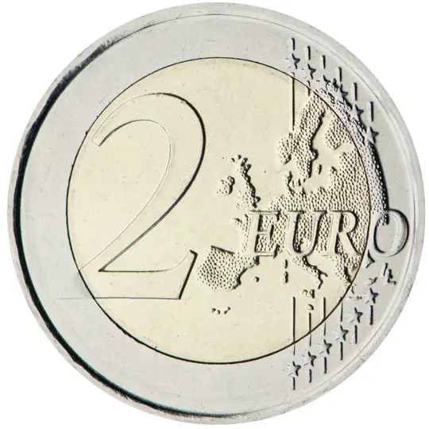
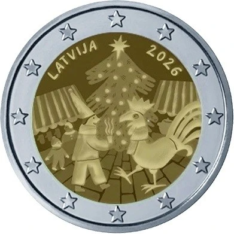

# Latvia € 2.00

## Images

## Metadata

**Country:** [Latvia](../../Countries/Latvia/index.md)\
**Monetary value:** € 2.00\
**Currency:** Euro\
**Issue date:** 2026-11-24\
**Designer:** Anna Vaivare

## Description

Christmas Markets

## Mintages

| Year | Mintmark | Circulated | Brilliant Uncirculated | Proof |
| ---- | -------- | ---------- | ---------------------- | ----- |
| 2026 |          | 400000     | 7000                   | 0     |

### Sources

- [Mintage Circulated](https://www.e-monetas.lv/en/news/latvijas-banka-will-issue-a-special-design-2-euro-coin-christmas-market)
- [Mintage BU](https://www.e-monetas.lv/en/news/latvijas-banka-will-issue-a-special-design-2-euro-coin-christmas-market)
- [Issue Date](https://www.e-monetas.lv/en/news/latvijas-banka-will-issue-a-special-design-2-euro-coin-christmas-market)
- [Designer](https://www.e-monetas.lv/en/news/latvijas-banka-will-issue-a-special-design-2-euro-coin-christmas-market)
