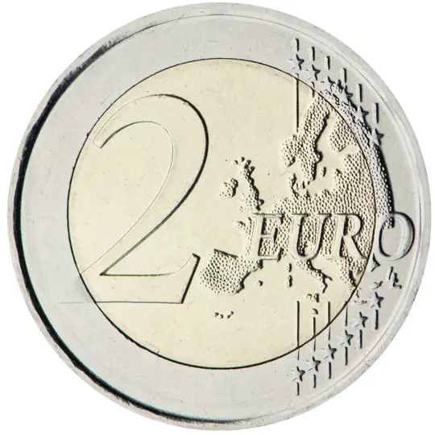

# San Marino € 2.00

## Images

## Metadata

**Country:** [San Marino](../../Countries/San%20Marino/index.md)\
**Monetary value:** € 2.00\
**Currency:** Euro\
**Issue date:** 2027\
**Designer:** 

## Description

300th Anniversary of the Death of Isaac Newton

## Mintages

| Year | Mintmark | Circulated | Brilliant Uncirculated | Proof |
| ---- | -------- | ---------- | ---------------------- | ----- |
| 2027 |          | 0          | 0                      | 0     |
