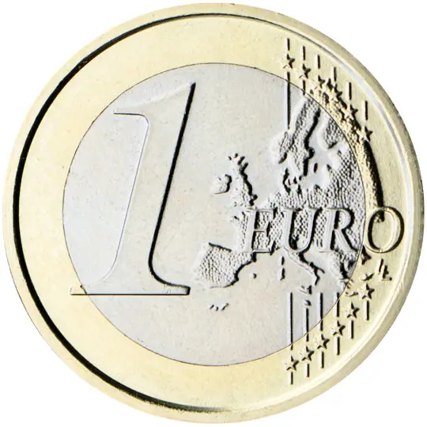
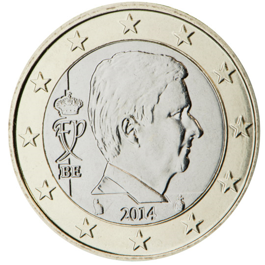

# Belgium € 1.00

## Images

## Metadata

**Country:** [Belgium](../index.md)\
**Serie:** [Belgium 2014 - ...](index.md)\
**Monetary value:** € 1.00\
**Currency:** Euro\
**Issue date:** 2014-02-04\
**Designer:** Luc Luycx

## Description

Profile picture of King Philippe of Belgium and royal monogram

## Mintages

| Year | Mintmark | Circulated | Brilliant Uncirculated | Proof |
| ---- | -------- | ---------- | ---------------------- | ----- |
| 2014 |          | 0          | 78000                  | 1500  |
| 2015 |          | 0          | 43000                  | 1000  |
| 2016 |          | 0          | 45000                  | 1000  |
| 2017 |          | 0          | 27500                  | 1000  |
| 2018 |          | 0          | 47000                  | 750   |
| 2019 |          | 0          | 27000                  | 1500  |
| 2020 |          | 0          | 20500                  | 1000  |
| 2021 |          | 0          | 14250                  | 0     |
| 2022 |          | 0          | 13500                  | 0     |
| 2023 |          | 0          | 21000                  | 0     |
| 2024 |          | 0          | 13500                  | 0     |
| 2025 |          | 0          | 0                      | 0     |
| 2026 |          | 0          | 0                      | 0     |

### Sources

- [Issue Date](https://www.gva.be/economie/koning-filip-stelt-eigen-munt-voor-album/30896687.html)

#### 2020

- Mintages Circulated [1](https://financien.belgium.be/sites/default/files/Cahiers-des-charges-bestek/2020-075%20-%20Bestek%20Eurostukken%20ERRATUM.pdf), [2](https://www.2021.jaarverslag.financien.belgium.be/pdf/RA2021-NL-20220712.pdf)

#### 2021

- Mintages Circulated (https://www.2021.jaarverslag.financien.belgium.be/pdf/RA2021-NL-20220712.pdf)

#### 2022

- Mintages Circulated (https://www.2022.jaarverslag.financien.belgium.be/pdf/2022-RA02-nl.pdf)

#### 2023

- Mintages Circulated (https://www.2023.jaarverslag.financien.belgium.be/pdf/RA2023-nl.pdf)

#### 2024

- Mintages Circulated (https://financien.belgium.be/sites/default/files/thesaurie/KMB/Jaarverslag%202024%20-%20Koninklijke%20Munt%20van%20België.pdf)

#### 2025

- Mintages Circulated (https://fin.belgium.be/sites/default/files/media/documents/Jaarverslag%202025-toegankelijke-versie_0.pdf)
