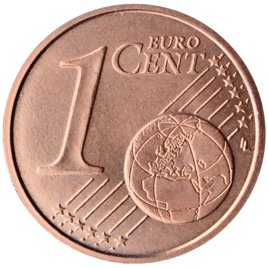
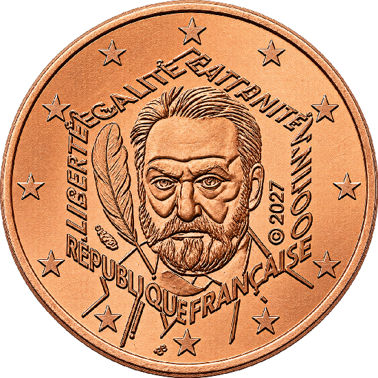

# France € 0.01

## Images

## Metadata

**Country:** [France](../index.md)\
**Serie:** [France 2022 - ...](index.md)\
**Monetary value:** € 0.01\
**Currency:** Euro\
**Designer:** 

## Description

Victor Hugo -  Author and former Deputy of the French National Assembly

## Mintages

| Year | Mintmark | Circulated | Brilliant Uncirculated | Proof |
| ---- | -------- | ---------- | ---------------------- | ----- |
| 2027 |          | 0          | 0                      | 0     |

### Sources

