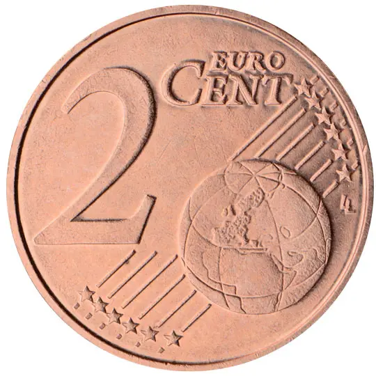
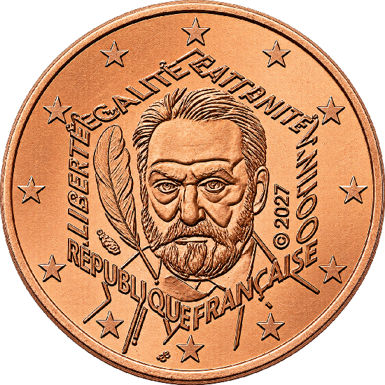

# France € 0.02

## Images

## Metadata

**Country:** [France](../index.md)\
**Serie:** [France 2022 - ...](index.md)\
**Monetary value:** € 0.02\
**Currency:** Euro\
**Designer:**

## Description

Victor Hugo -  Author and former Deputy of the French National Assembly

## Mintages

| Year | Mintmark | Circulated | Brilliant Uncirculated | Proof |
| ---- | -------- | ---------- | ---------------------- | ----- |
| 2024 |          | 120000000  | 30000                  | 5000  |
| 2025 |          | 116000000  | 43000                  | 0     |
| 2026 |          | 0          | 0                      | 0     |

### Sources

- [Mintage Circulated 2024-2025](https://www.ccomptes.fr/sites/default/files/2025-09/20250911-S2025-1095-Monnaie%20de%20Paris.pdf)

