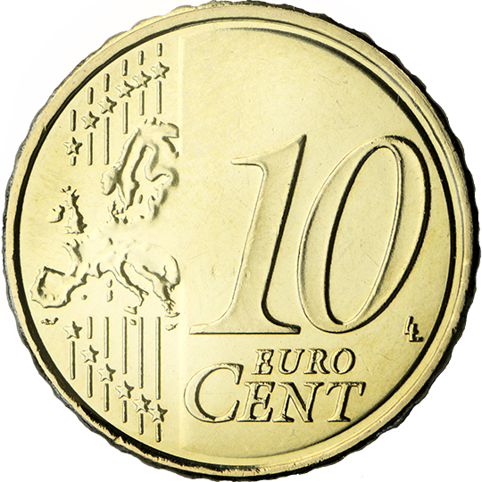
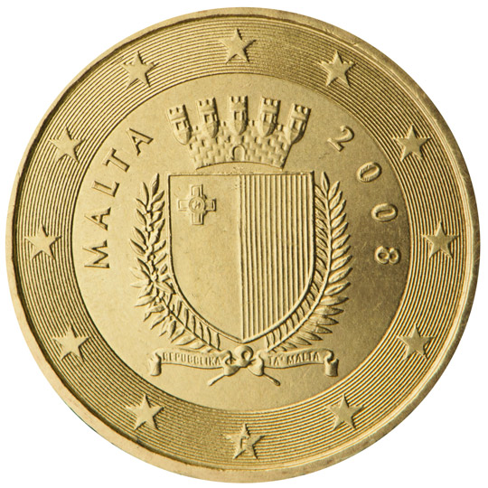

# Malta € 0.10

## Images

## Metadata

**Country:** [Malta](../index.md)\
**Serie:** [Malta 2008 - ...](index.md)\
**Monetary value:** € 0.10\
**Currency:** Euro\
**Designer:** Noel Galea Bason

## Description

National coat of arms of Malta

## Mintages

| Year | Mintmark | Circulated | Brilliant Uncirculated | Proof |
| ---- | -------- | ---------- | ---------------------- | ----- |
| 2008 |          | 41000000   | 40000                  | 0     |
| 2011 |          | 0          | 50000                  | 0     |
| 2012 |          | 0          | 50000                  | 0     |
| 2013 |          | 0          | 35000                  | 0     |
| 2014 |          | 0          | 25000                  | 0     |
| 2015 |          | 0          | 30000                  | 0     |
| 2016 |          | 200000     | 35000                  | 0     |
| 2017 |          | 2500000    | 30000                  | 0     |
| 2018 |          | 0          | 17000                  | 0     |
| 2019 |          | 7000000    | 15000                  | 0     |
| 2020 |          | 2500000    | 10000                  | 0     |
| 2021 |          | 3100000    | 11000                  | 0     |
| 2022 |          | 1110000    | 10000                  | 0     |
| 2023 |          | 2300000    | 10000                  | 0     |
| 2024 |          | 0          | 10000                  | 0     |
| 2025 |          | 0          | 7000                   | 0     |
| 2026 |          | 1500000    | 5000                   | 0     |

### Sources

#### 2020-2025

- Mintages Circulated (https://www.centralbankmalta.org/site/excel/Currency/Coin-Circulation-Production.xlsx?revcount=1058&revcount=6438)

#### 2020

- Mintages BU (https://www.centralbankmalta.org/dated-set-2020)

#### 2021

- Mintages BU (https://www.centralbankmalta.org/dated-set-2021)

#### 2022

- Mintages BU (https://www.centralbankmalta.org/dated-set-2022)

#### 2023

- Mintages BU (https://www.centralbankmalta.org/dated-set-2023)

#### 2024

- Mintages BU (https://www.centralbankmalta.org/dated-set-2024)

#### 2025

- Mintages BU (https://www.centralbankmalta.org/dated-set-2025)