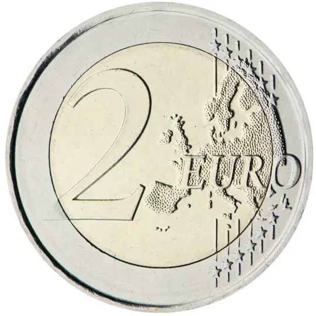
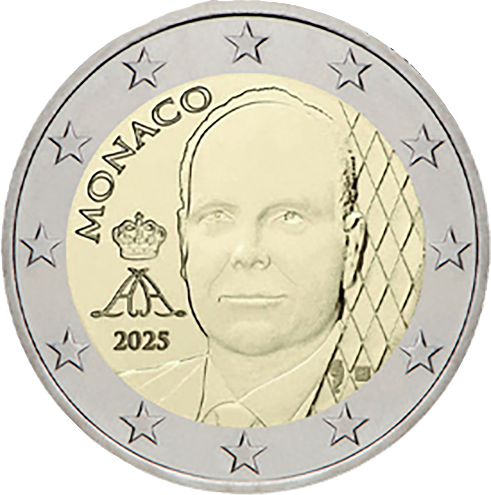

# Monaco € 2.00

## Images

## Metadata

**Country:** [Monaco](../index.md)\
**Serie:** [Monaco 2025 - ...](index.md)\
**Monetary value:** € 2.00\
**Currency:** Euro\
**Designer:** Joaquin Jimenez

## Description

Portrait of Prince Albert II

## Mintages

| Year | Mintmark | Circulated | Brilliant Uncirculated | Proof |
| ---- | -------- | ---------- | ---------------------- | ----- |
| 2025 |          | 1207000    | 0                      | 0     |
| 2026 |          | 0          | 0                      | 0     |

### Sources

- [Mintage Circulated 2025](https://journaldemonaco.gouv.mc/Journaux/2025/Journal-8764/Ordonnance-Souveraine-n-11.455-du-5-septembre-2025-modifiant-l-Ordonnance-Souveraine-n-15.191-du-17-janvier-2002-autorisant-l-emission-et-la-mise-en-circulation-de-pieces-de-monnaie-de-0-01-0-02-0-05-0-10-0-20-0-50-1-et-2-euros-modifiee)
