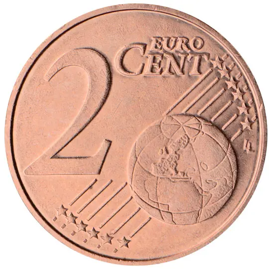

# San Marino € 0.02

## Images

## Metadata

**Country:** [San Marino](../index.md)\
**Serie:** [San Marino 2017 - ...](index.md)\
**Monetary value:** € 0.02\
**Currency:** Euro\
**Designer:** Arno Ludwig, Ettore Lorenzo Frapiccini

## Description

The City Gate

## Mintages

| Year | Mintmark | Circulated | Brilliant Uncirculated | Proof |
| ---- | -------- | ---------- | ---------------------- | ----- |
| 2017 |          | 0          | 36000                  | 2600  |
| 2018 |          | 0          | 25000                  | 2600  |
| 2019 |          | 0          | 23000                  | 2500  |
| 2020 |          | 0          | 22000                  | 0     |
| 2021 |          | 0          | 0                      | 2500  |
| 2022 |          | 0          | 11000                  | 0     |
| 2023 |          | 0          | 20000                  | 0     |
| 2024 |          | 0          | 18000                  | 3000  |
| 2025 |          | 0          | 18000                  | 3000  |
| 2026 |          | 0          | 0                      | 0     |

### Sources

#### 2020
- Mintage Circulated [1](https://www.bollettinoufficiale.sm/on-line/RicercaBU?operation=getDocBU&id=cabdc7be55ce2fe0f312c7507508ac1c05389604), [2](https://dfn.sm/en/archive/cod-323-2020.html), [3](https://dfn.sm/en/archive/cod-324-2020.html)

#### 2021
- Mintage Circulated [1](https://www.bollettinoufficiale.sm/on-line/RicercaBU?operation=getDocBU&id=3bab1f0d6c91dede7b45c80e7ffeb9c9af540760), [2](https://dfn.sm/en/archive/cod-333-2021.html), [3](https://dfn.sm/en/shop/cod-334-2021.html)

#### 2022
- Mintage Circulated [1](https://www.bollettinoufficiale.sm/on-line/RicercaBU?operation=getDocBU&id=7add4a6b0eb0071eaa90438d7d852e660198d1d1), [2](https://dfn.sm/en/archive/cod-345-2022.html), [3](https://dfn.sm/en/archive/cod-346-2022.html), [4](https://dfn.sm/en/shop/coincard-923-2022.html), [5](https://dfn.sm/en/coincard-924-2022.html)

#### 2023
- Mintage Circulated [1](https://www.bollettinoufficiale.sm/on-line/RicercaBU?operation=getDocBU&id=9de89436f605764135bb857b57e6162dcbd3b368), [2](https://dfn.sm/en/monetazione-divisionale-fior-di-conio-2023.html), [3](https://dfn.sm/en/numismatica/monetazione-divisionale-fior-di-conio-2023-5-euro-argento-protezione-della-fauna-selvatica-di-san-marino.html)

#### 2024
- Mintage Circulated [1](https://www.bollettinoufficiale.sm/on-line/RicercaBU?operation=getDocBU&id=2d95834737721c347de5821b2c214bd2c93ae72c), [2](https://dfn.sm/en/monetazione-divisionale-fior-di-conio-2024.html), [3](https://dfn.sm/en/numismatica/monetazione-divisionale-fior-di-conio-2024-5-euro-argento-farfalle.html), [4](https://dfn.sm/en/coincard-bandiera-della-repubblica-di-san-marino.html)
- Mintage BU [1](https://dfn.sm/en/monetazione-divisionale-fior-di-conio-2024.html), [2](https://dfn.sm/en/numismatica/monetazione-divisionale-fior-di-conio-2024-5-euro-argento-farfalle.html)

#### 2025
- Mintage Circulated [1](https://www.bollettinoufficiale.sm/on-line/RicercaBU?operation=getDocBU&id=c251acea5da2510d6423f6c10b06f68263efa5be), [2](https://www.dfn.sm/en/divisionale-fdc-2025-8-pz.html), [3](https://dfn.sm/en/news/divisionale-fdc-5-euro-2025-9-pz.html)
